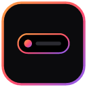

<p align="center"></p>

<h1 align="center">Ilha</h1>

<p align="center">
  Uma <b>Dynamic Island para Windows</b>: uma pílula no topo da tela que acompanha o <b>Claude Code</b> e o <b>Codex</b>,<br>
  deixa você <b>permitir ou negar</b> ações sem abrir o terminal e avisa quando a IA termina.
</p>

<p align="center">
  <a href="https://github.com/josevictoremiliano/island/releases/latest"></a>
  <a href="https://github.com/josevictoremiliano/island/actions/workflows/ci.yml"></a>
  
  
</p>

---

## Instalar

1. Baixe **`Ilha_x.y.z_x64-setup.exe`** na [última versão](https://github.com/josevictoremiliano/island/releases/latest).
2. Abra o instalador. Se o Windows disser *"O Windows protegeu o computador"*, clique em **Mais informações → Executar assim mesmo** (o app ainda não tem certificado de assinatura de código).
3. A ilha aparece no topo da tela. Abra **Configurações → Conexões** e ligue o **Claude Code** e/ou o **Codex**.

A partir daí a Ilha **se atualiza sozinha**: ela confere o GitHub, baixa a versão nova mostrando o progresso e instala quando nenhuma IA estiver trabalhando.

## O que ela faz

| | |
|---|---|
| **IA ao vivo** | O que o Claude Code ou o Codex está fazendo agora: lendo, editando, rodando comandos. Cores para trabalhando, pergunta, pronto e erro |
| **Permitir / Negar** | Pedidos de permissão do Claude Code direto na ilha (Permitir, Sempre permitir, Negar, Aprovar plano) |
| **Avisos** | Cartões embaixo da ilha ou notificação do Windows, por tipo: terminou, pergunta, erro, limite de 5h quase cheio, timer, agenda, bateria, atualização |
| **Uso do plano** | Anel do limite de 5 horas e da semana (Claude pela status line, Codex pelos arquivos de sessão) |
| **Música** | Qualquer player do Windows: capa, progresso, controles e letras sincronizadas |
| **Ferramentas** | Bandeja de arquivos (arraste para dentro e para fora), área de transferência, nota, timer de foco, Guarda do Foco, agenda (iCal), clima, Wi‑Fi e Bluetooth, CPU/RAM/bateria, até 4 atalhos para sites e programas |
| **Do seu jeito** | Colada no topo ou flutuante, preta ou vidro colorido, tamanho, transparência, o que aparece em repouso, sons (4 pacotes), atalho de teclado, modo linha (botão direito) |

Tudo roda no seu PC. Sem conta, sem servidor da Ilha. Veja [docs/privacidade.md](docs/privacidade.md).

## Desenvolvimento

Precisa de [Rust](https://rustup.rs) e [Node.js](https://nodejs.org) 20+.

```powershell
git clone https://github.com/josevictoremiliano/island.git
cd island
npm install
npm run dev      # abre a Ilha em modo desenvolvimento
```

- `src-tauri/` é o backend em Rust; `src/` é a interface (HTML, CSS e JS, sem bundler).
- `src-tauri\target\debug\ilha.exe --probe` mostra o que a Ilha lê agora (música, sistema, rede, uso).
- A documentação completa está em **[docs/](docs/README.md)**.

## Lançar uma versão

```powershell
.\scripts\release.ps1 0.2.0
```

O script atualiza a versão, cria a tag e envia. O GitHub Actions compila, assina e publica a release com o `latest.json` que as Ilhas instaladas usam para se atualizar. Detalhes em [docs/atualizacoes-e-releases.md](docs/atualizacoes-e-releases.md).
